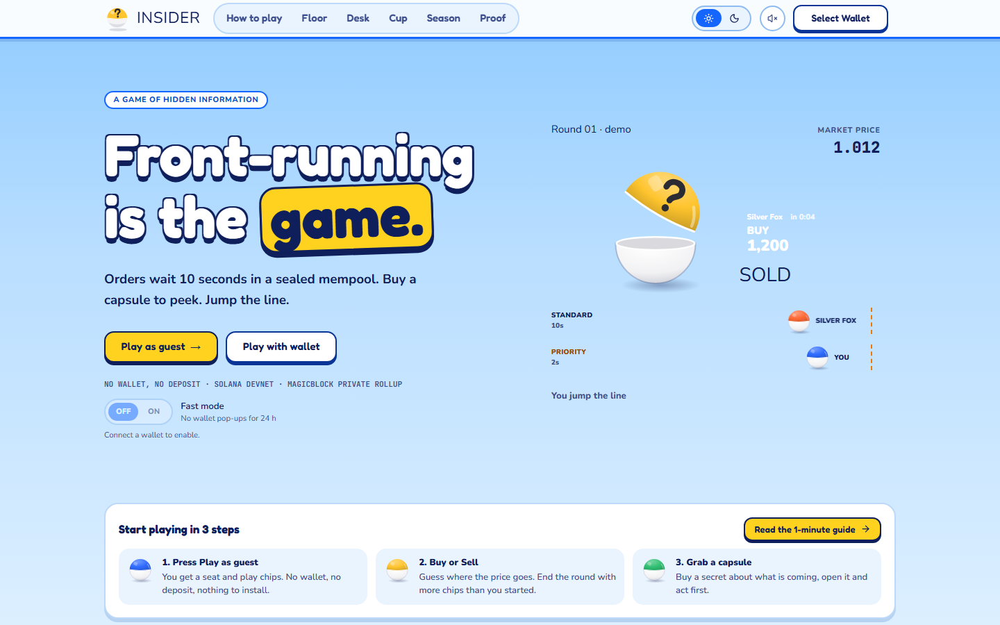
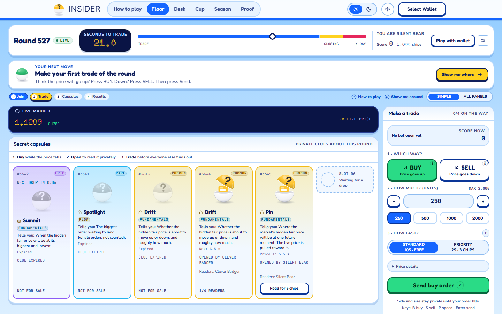
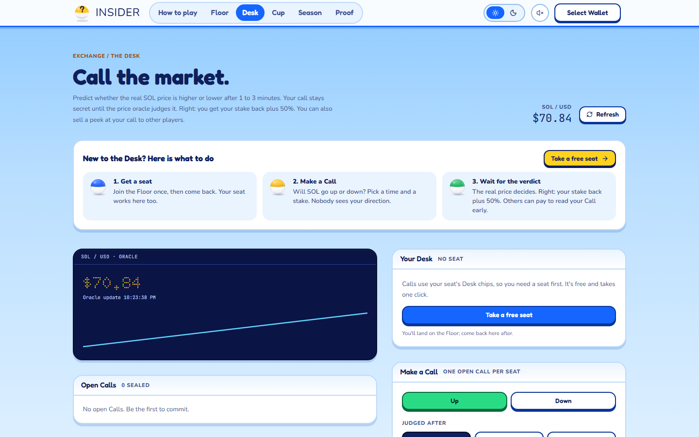
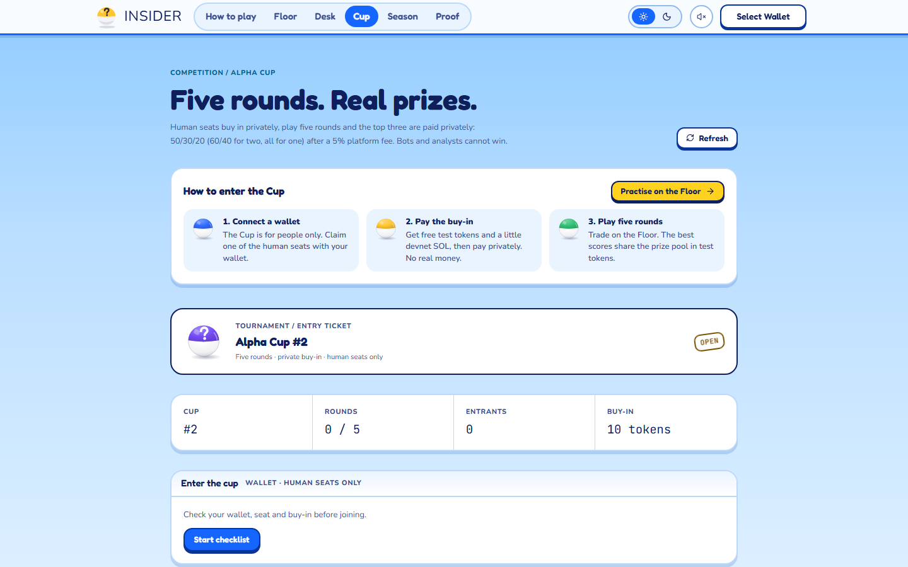
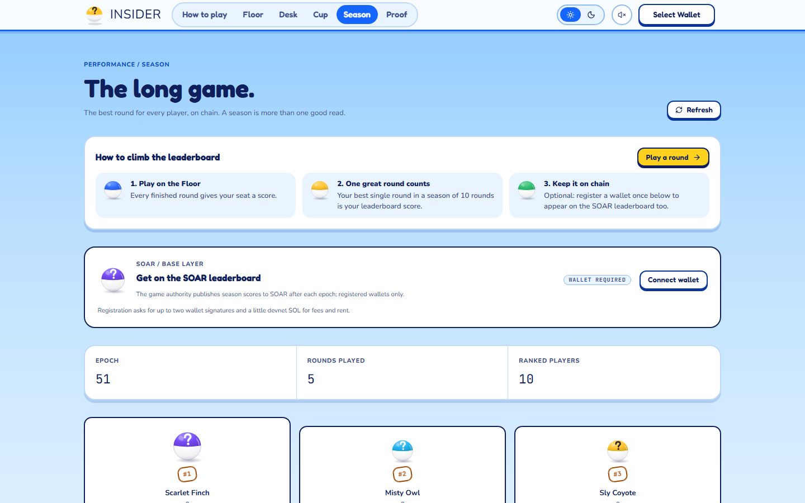
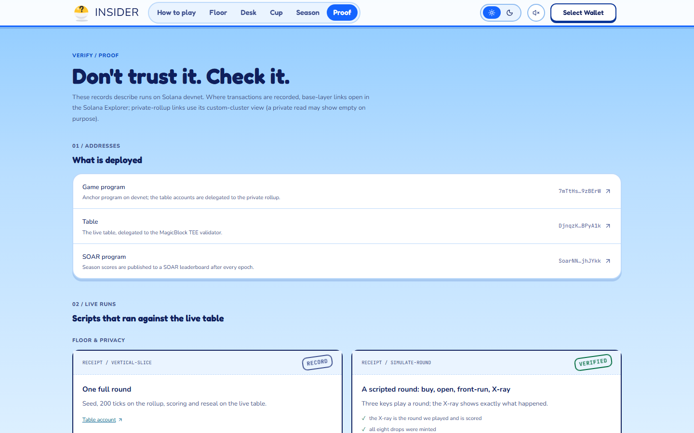
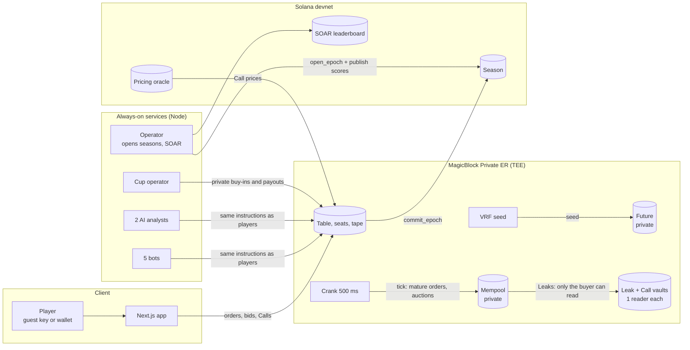

<div align="center">


### Own the edge. Front-running is the game.

A real-time multiplayer game where you **own private information as an on-chain asset** — buy it, sell it, license it, or burn it — powered by **MagicBlock's Private Ephemeral Rollup** on Solana.

## 🎮 [Play live: insiderz.vercel.app](https://insiderz.vercel.app) · 🎬 [Watch the demo video](https://drive.google.com/file/d/1zA6peELMkUwLChy4KaTXHdgomzYSZ4EI/view?usp=sharing)

[](https://insiderz.vercel.app)
[](https://drive.google.com/file/d/1zA6peELMkUwLChy4KaTXHdgomzYSZ4EI/view?usp=sharing)
[](https://explorer.solana.com/address/7mTtHsFMYnZRnhd3SRzhj8Nm1U2T3s33dnbJwa9zBErW?cluster=devnet)
[](LICENSE)

**Solana Blitz v10 · MagicBlock · Theme: Entertainment Finance**

<a href="https://insiderz.vercel.app"></a>

</div>

---

## Screenshots

<table>
  <tr>
    <td width="50%"><br/><b>The Floor</b>: a live round with sealed capsules and the trade panel</td>
    <td width="50%"><br/><b>The Desk</b>: private calls on the real SOL/USD oracle price</td>
  </tr>
  <tr>
    <td width="50%"><br/><b>Alpha Cup</b>: five-round tournament with private buy-ins and payouts</td>
    <td width="50%"><br/><b>Season</b>: on-chain leaderboard published to SOAR</td>
  </tr>
  <tr>
    <td colspan="2"><br/><b>Proof</b>: every claim backed by a devnet transaction</td>
  </tr>
</table>

---

## Table of contents

- [Screenshots](#screenshots)
- [Overview](#overview)
- [Try it in three minutes](#try-it-in-three-minutes)
- [How to play](#how-to-play)
- [Game modes](#game-modes)
- [How MagicBlock powers INSIDER](#how-magicblock-powers-insider)
- [Architecture](#architecture)
- [Privacy model](#privacy-model)
- [Verified on devnet](#verified-on-devnet)
- [Deployed addresses](#deployed-addresses)
- [Run it locally](#run-it-locally)
- [Repository layout](#repository-layout)
- [Known limits](#known-limits)
- [What's next](#whats-next)
- [Team](#team)

---

## Overview

INSIDER is a **game about owning information**. Ten seats share one table: you, other players, five bots and two AI analysts. Each round lasts about 100 seconds, and you win by knowing something the others don't.

- **Every move is hidden.** Orders wait for 10 seconds in a sealed dark mempool inside a TEE. Rivals see _who_ traded, never _what_.
- **Leaks are tradeable assets.** Every 10 seconds a sealed clue drops in a falling-price auction. The winner **owns** it on-chain, then chooses to **open** it, **flip** it sealed for profit, or **license** read access to others.
- **Calls are your track record.** On The Desk, make a private prediction on the real SOL price. Your on-chain record of right and wrong calls is an asset you build over seasons.
- **Every round ends in a replay.** The **X-ray** reveals every hidden order, Leak and front-run, so you see exactly how you were read.

Free to play on Solana devnet. No wallet, deposit or real money needed — the Alpha Cup pays out from a prize pool in a devnet token.

| Resource       | Link                                                                                                                            |
| -------------- | ------------------------------------------------------------------------------------------------------------------------------- |
| Live app       | [insiderz.vercel.app](https://insiderz.vercel.app)                                                                              |
| Demo video     | [Google Drive](https://drive.google.com/file/d/1zA6peELMkUwLChy4KaTXHdgomzYSZ4EI/view?usp=sharing)                              |
| Services       | [insider-services.onrender.com/health](https://insider-services.onrender.com/health) (bots, AI analysts, operators)             |
| Game program   | [`7mTtHsF…BErW`](https://explorer.solana.com/address/7mTtHsFMYnZRnhd3SRzhj8Nm1U2T3s33dnbJwa9zBErW?cluster=devnet)               |
| Live table     | [`DjnqzKQ…A1k`](https://explorer.solana.com/address/DjnqzKQsUU1fmRztBAiUkPn8VwsnFYgMedcg1BPyA1k?cluster=devnet) (TEE-delegated) |
| On-chain proof | [docs/proofs](docs/proofs/README.md) and the app's `/proof` page                                                                |

---

## Try it in three minutes

1. Open [insiderz.vercel.app](https://insiderz.vercel.app) and press **Play as guest**. You get a seat and 1,000 chips.
2. On the **Floor**, follow the **Your next move** bar and send an order. It stays hidden until it lands.
3. Win a **Leak** in its auction, **open** it, and see what it reveals.
4. After the round, check the **X-ray** replay.
5. Explore **Desk**, **Cup**, **Season** and **Proof** (every transaction behind the claims below).

Optional, from a terminal: `pnpm privacy-test` tries to read sealed data as four parties; `pnpm session-demo` shows a key holding 0 SOL playing for a wallet.

---

## How to play

| Step                | What happens                                                                                            |
| ------------------- | ------------------------------------------------------------------------------------------------------- |
| **1. Join**         | Press **Play as guest**. You get a seat and 1,000 play chips.                                           |
| **2. Trade**        | **BUY** or **SELL**. Orders land in 10 s on the free Standard lane, or 2 s on Priority for a few chips. |
| **3. Grab a Leak**  | A private clue in a Dutch auction. **Open** it to read it, or **resell** it unread.                     |
| **4. Finish ahead** | Trade for 80 s. At 90 s all positions close; your score is chips minus 1,000.                           |
| **5. Replay**       | The **X-ray** shows every hidden order and secret. The next round starts with fresh chips.              |

**Keyboard:** `B` buy · `S` sell · `P` switch lane · `Enter` send

The app guides new players with a first-visit tutorial, a **Your next move** hint bar, a **Show me around** tour, a **Simple / All panels** toggle, and a [rules page](https://insiderz.vercel.app/rules).

---

## Game modes

| Mode          | Description                                                                                                                      |
| ------------- | -------------------------------------------------------------------------------------------------------------------------------- |
| **The Floor** | The core 100-second round: hidden orders, Leaks, front-running and the X-ray replay.                                             |
| **The Desk**  | Make a private call on the real SOL price, sell licences to read it, and get judged by the oracle. Builds a public track record. |
| **Alpha Cup** | A five-round tournament with private buy-ins and a prize pool paid out on-chain.                                                 |
| **Season**    | Ten rounds make an epoch; top scores are published to **SOAR**, MagicBlock's on-chain leaderboard.                               |

---

## How MagicBlock powers INSIDER

| Feature                   | Role in INSIDER                                                                          | Status                               |
| ------------------------- | ---------------------------------------------------------------------------------------- | ------------------------------------ |
| **Ephemeral Rollup**      | The whole table runs delegated: 500 ms ticks, order maturity, auctions, zero-fee trades. | ✅ Live — 500+ rounds on devnet      |
| **Private ER (TEE)**      | Hides the mempool, the round's future, and every sealed Leak and Call.                   | ✅ 43 / 43 privacy probes passed     |
| **Ephemeral permissions** | Opening, flipping or licensing a Leak rewrites who the TEE lets read that account.       | ✅ Live                              |
| **VRF**                   | One seed per round writes the hidden price path, whale orders and Leak schedule.         | ✅ Every round                       |
| **Cranks**                | A 500 ms crank runs `tick`. No game server, no keeper script.                            | ✅ Never ran out in the soak         |
| **Pricing Oracle**        | Real SOL/USD for The Desk: call snapshots and settlement.                                | ✅ Calls minted and judged on devnet |
| **Private Payments**      | Alpha Cup buy-ins and private prize payouts.                                             | ✅ Live on devnet                    |
| **Session Keys**          | Pop-up-free play: a key with no SOL signs for the wallet.                                | ✅ Live on devnet                    |
| **SOAR**                  | Season scores published to an on-chain leaderboard.                                      | ✅ Live                              |

---

## Architecture



1. **Delegation.** Table accounts live on Solana and are delegated to the TEE validator for play.
2. **Cranks.** A scheduled crank drives the game loop; bots re-arm it every 10 minutes and score rounds.
3. **Privacy by permission.** Private accounts hold the mempool, the future and every sealed Leak. A Leak that was never opened has provably never been read.
4. **VRF.** Each round's hidden future is seeded inside the TEE.
5. **Epochs.** Every 10 rounds, `commit_epoch` returns the season to Solana, scores go to SOAR, and `open_epoch` delegates a new season.

---

## Privacy model

|                                         |       Owner        | Other players | Anyone (RPC) | After round (X-ray) |
| --------------------------------------- | :----------------: | :-----------: | :----------: | :-----------------: |
| Who sent an order, and when             |         ✓          |       ✓       |      ✓       |          ✓          |
| An order's side and size, while pending |         ✓          |       ✕       |      ✕       |          ✓          |
| A sealed Leak's content                 |   reader(s) only   |       ✕       |      ✕       |  opened Leaks only  |
| A Call's direction                      | author + licensees |       ✕       |      ✕       |    ✓ once judged    |
| The VRF future                          |         ✕          |       ✕       |      ✕       |      revealed       |

Verified by [`pnpm privacy-test`](docs/proofs/privacy-test.json): 43 read attempts by the opener, another seat, the authority and an anonymous client, all behaving as designed.

---

## Verified on devnet

Every claim links to a proof file produced by a script against the live table.

| Claim                                                                              | Evidence                                                 |
| ---------------------------------------------------------------------------------- | -------------------------------------------------------- |
| **60-minute stress test:** 35 rounds, 3 epochs, 2,366 txns, **0 failed**, 0 stalls | [`soak.json`](docs/proofs/soak.json)                     |
| **Human on the live table** alongside bots: joined, traded, scored                 | [`go-live.json`](docs/proofs/go-live.json)               |
| No unauthorised party can read sealed data (43 probes)                             | [`privacy-test.json`](docs/proofs/privacy-test.json)     |
| Scripted round: buy, open, front-run, X-ray                                        | [`simulate-round.json`](docs/proofs/simulate-round.json) |
| The Desk: private call, licence sale, oracle verdict                               | [`desk.json`](docs/proofs/desk.json)                     |
| Alpha Cup: private buy-ins, five rounds, 60/40 private payouts                     | [`cup.json`](docs/proofs/cup.json)                       |
| Session keys: a 0-SOL key plays for a wallet; invalid keys refused                 | [`session.json`](docs/proofs/session.json)               |
| SOAR: season scores on the leaderboard                                             | [`soar.json`](docs/proofs/soar.json)                     |
| Epoch cycle: commit to base layer and re-delegate                                  | [`epoch.json`](docs/proofs/epoch.json)                   |
| Recovery: undelegation honoured, table rebuilt from base layer                     | [`recovery.json`](docs/proofs/recovery.json)             |

**Tests:** 197 Rust tests (LiteSVM) and 280 TypeScript tests. CI runs format, lint, typecheck, tests, the web build and `cargo check` on every push.

---

## Deployed addresses

All values are public. No private keys are in this repository.

<details>
<summary><b>INSIDER programs and accounts (Solana devnet)</b></summary>

| What                      | Address                                                                                                                                           |
| ------------------------- | ------------------------------------------------------------------------------------------------------------------------------------------------- |
| Game program              | [`7mTtHsFMYnZRnhd3SRzhj8Nm1U2T3s33dnbJwa9zBErW`](https://explorer.solana.com/address/7mTtHsFMYnZRnhd3SRzhj8Nm1U2T3s33dnbJwa9zBErW?cluster=devnet) |
| Upgrade / table authority | [`23k9UnCKBkFyci6Sv1RhuFXUXFgTnjV6oeTZyMaxopWm`](https://explorer.solana.com/address/23k9UnCKBkFyci6Sv1RhuFXUXFgTnjV6oeTZyMaxopWm?cluster=devnet) |
| Table (PDA)               | [`DjnqzKQsUU1fmRztBAiUkPn8VwsnFYgMedcg1BPyA1k`](https://explorer.solana.com/address/DjnqzKQsUU1fmRztBAiUkPn8VwsnFYgMedcg1BPyA1k?cluster=devnet)   |
| SOAR game                 | [`dQPfJzesPQSGYueDrf7UFskt3nFHo4nmQyeSgJYEphF`](https://explorer.solana.com/address/dQPfJzesPQSGYueDrf7UFskt3nFHo4nmQyeSgJYEphF?cluster=devnet)   |
| SOAR leaderboard          | [`HRLwsB4PeVTE8Lm2RVDoYfYtT3FCGYxH7F1A2e9rryib`](https://explorer.solana.com/address/HRLwsB4PeVTE8Lm2RVDoYfYtT3FCGYxH7F1A2e9rryib?cluster=devnet) |
| Alpha Cup test token      | `2P93g7wmAgD8126oJbNWfHDkejiEyYJCcHYT7UiprLio`                                                                                                    |
| Delegated accounts        | 37 (table, seats, markets, private vaults, cup)                                                                                                   |

</details>

<details>
<summary><b>MagicBlock endpoints and programs</b></summary>

| What                     | Value                                                                                         |
| ------------------------ | --------------------------------------------------------------------------------------------- |
| TEE RPC (Private ER)     | `https://devnet-tee.magicblock.app`                                                           |
| TEE validator            | `MTEWGuqxUpYZGFJQcp8tLN7x5v9BSeoFHYWQQ3n3xzo`                                                 |
| Magic Router             | `https://devnet-router.magicblock.app` / `wss://devnet-router.magicblock.app`                 |
| Delegation program       | `DELeGGvXpWV2fqJUhqcF5ZSYMS4JTLjteaAMARRSaeSh`                                                |
| Magic program / context  | `Magic11111111111111111111111111111111111111` / `MagicContext1111111111111111111111111111111` |
| Permission program (ACL) | `ACLseoPoyC3cBqoUtkbjZ4aDrkurZW86v19pXz2XQnp1`                                                |
| VRF queue                | `5hBR571xnXppuCPveTrctfTU7tJLSN94nq7kv7FRK5Tc`                                                |
| Pricing oracle (SOL/USD) | `ENYwebBThHzmzwPLAQvCucUTsjyfBSZdD9ViXksS4jPu`                                                |
| Session keys (Gum)       | `KeyspM2ssCJbqUhQ4k7sveSiY4WjnYsrXkC8oDbwde5`                                                 |
| SOAR program             | `SoarNNzwQHMwcfdkdLc6kvbkoMSxcHy89gTHrjhJYkk`                                                 |

</details>

---

## Run it locally

**Prerequisites:** Node 24 · pnpm 10 · Rust 1.89 · Solana CLI 4.x · Anchor CLI 1.2.2 (program only)

```bash
pnpm install
cp .env.example .env            # services and scripts (defaults point at devnet)
cp .env.example app/.env.local  # the app; uses the hosted services
pnpm dev                        # http://localhost:3000  (offline UI: /table?fixture=1)
pnpm test                       # TypeScript tests
cd programs && cargo test -p insider   # program tests
```

<details>
<summary><b>Run the table and services</b> (needs the deployer key in <code>.keys/</code>)</summary>

```bash
pnpm setup-table --arm   # create and delegate table accounts, arm the crank (idempotent)
pnpm fund --all          # top up bot wallets
pnpm bots                # 5 bots: also score rounds, reseal Leaks, re-arm the crank
pnpm operator            # opens each season and publishes to SOAR
pnpm cup-operator        # Alpha Cup buy-ins and payouts
pnpm analysts            # 2 AI analysts (set XAI_API_KEY, GROQ_API_KEY or ANTHROPIC_API_KEY)
```

All services in one process (as on Render): `pnpm --filter bots host`. Run only one copy at a time.

Program: `pnpm program:build`, `pnpm program:idl`, `pnpm program:deploy`. Hosting and operations: [docs/runbook.md](docs/runbook.md). SDK: [docs/api.md](docs/api.md).

The public devnet RPC rate-limits; use your own `SOLANA_RPC_URL` for long runs.

</details>

---

## Repository layout

```
programs/insider/   Anchor program: instructions, engine, math, state, LiteSVM tests
sdk/                Typed TypeScript client: accounts, builders, TEE auth, oracle decoder
app/                Next.js app: Floor, Leaks, X-ray, Season, Desk, Cup, Rules, Proof
bots/               5 bots, 2 AI analysts, commentary, operator, cup operator
scripts/            Setup, gates, demos and proof generators
docs/               Spec, build plan, gates, runbook, SDK guide, devnet proofs
```

**Stack:** Rust + Anchor (`ephemeral-rollups-sdk` 0.18 with `vrf`, `access-control`, `crank`; `session-keys` 3.1) · TypeScript · Next.js · Tailwind CSS · lightweight-charts. AI analysts run on Groq, Grok (xAI) or Claude.

Further reading: [Technical spec](docs/TECHNICAL_SPEC.md) · [Project info](docs/PROJECT_INFO.md) · [Build plan](docs/STEPS.md)

---

## Known limits

- **Magic Action cut on purpose.** A post-commit action on `commit_epoch` would need a funded escrow per seat, and a failing action could stall the epoch cycle. The operator publishes to SOAR instead.
- **Private payments take ~150 s on devnet.** Cup buy-ins and payouts use the scripted path; the browser flow falls back to the operator if the payment doesn't arrive in time.
- **VRF callback (G10) not wired.** The VRF request lands but the on-chain callback is not consumed; the round seed is applied by the crank instead.
- **The TEE is the trust anchor.** Privacy relies on MagicBlock's validator and its permission checks, not on client-side encryption.

---

## What's next

- **Mainnet.** The game runs on devnet today. A mainnet launch would replace the play-money token with real value.
- **More human play-testing.** The 60-minute stress test and the human play session prove the engine; a public beta will prove the meta-game.

Built during Solana Blitz v10 (Nov 20–27, 2026) with the help of Claude Code. Every claim above is backed by a script run against devnet.

---

## Team

|                   |                                                                              |
| ----------------- | ---------------------------------------------------------------------------- |
| **Anurag Dubey**  | [GitHub](https://github.com/anuraggdubey) · [X](https://x.com/ANURAGGDUBEYY) |
| **Misbah Ansari** | [GitHub](https://github.com/MisbahAnsar) · [X](https://x.com/Misbahtwts)     |

**Solana Blitz v10** by MagicBlock.

## License

MIT. See [LICENSE](LICENSE).
