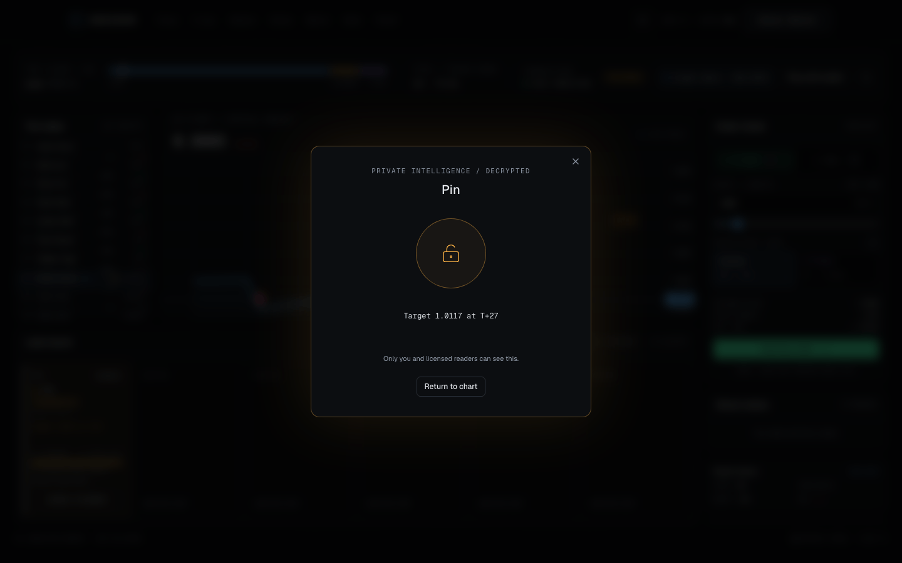
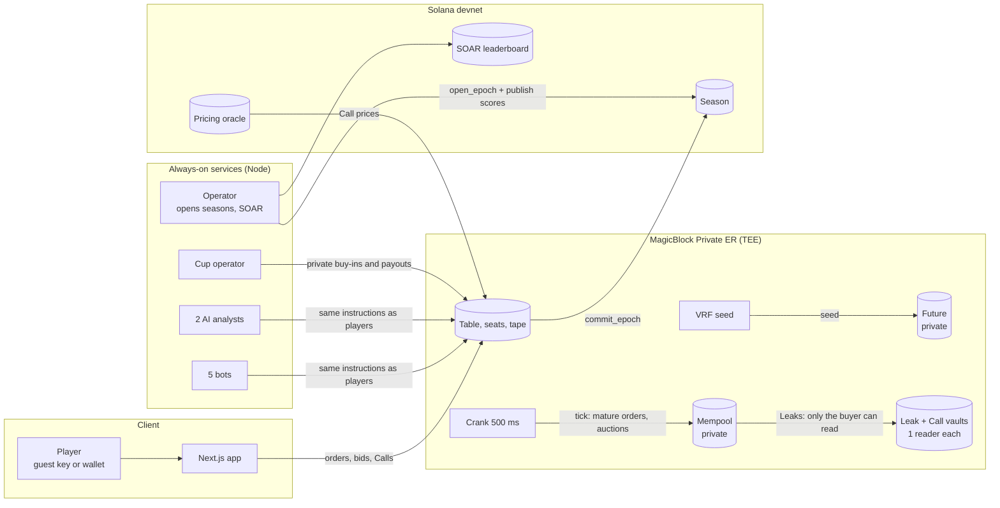
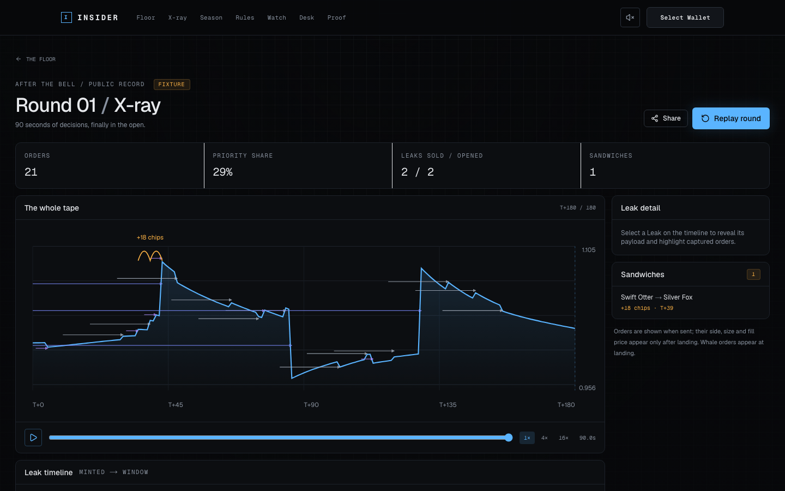
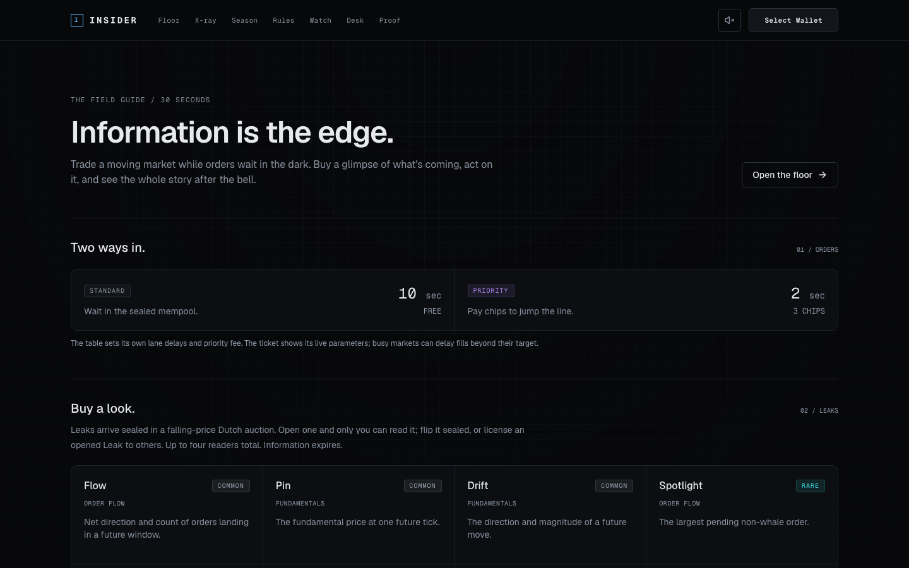

<h1 align="center">INSIDER</h1>

<h3 align="center">Own the secret. Front-running is the game.</h3>

<p align="center">
  A multiplayer <b>game of hidden information</b> on Solana. Every round is a 100-second fight to learn what the others can't see.<br>
  Moves wait in a sealed dark mempool inside MagicBlock's Private Ephemeral Rollup. Nobody can read them: not the other players, not the RPC, not us.
</p>

<p align="center">
  
  
  
</p>

<p align="center">
  <b><a href="LIVE_APP_URL">▶ Live app</a></b> &nbsp;·&nbsp; <b><a href="DEMO_VIDEO_URL">🎬 Demo video</a></b>
</p>

<p align="center">
  
</p>

Built by **Anurag Dubey** and **Misbah Ansari** for **Solana Blitz v10** (MagicBlock, theme: _Entertainment Finance_). The setting is a trading floor, but INSIDER is played like a game: rounds, scores, rivals and replays, with play-money chips. Everything below runs on **Solana devnet**; nothing here uses real funds.

|                    |                                                                                                                                                                                            |
| ------------------ | ------------------------------------------------------------------------------------------------------------------------------------------------------------------------------------------ |
| Live app           | _added when deployed_                                                                                                                                                                      |
| Demo video         | _added when recorded_                                                                                                                                                                      |
| Game program       | [`7mTtHsFMYnZRnhd3SRzhj8Nm1U2T3s33dnbJwa9zBErW`](https://explorer.solana.com/address/7mTtHsFMYnZRnhd3SRzhj8Nm1U2T3s33dnbJwa9zBErW?cluster=devnet) (devnet)                                 |
| Live table         | [`DjnqzKQsUU1fmRztBAiUkPn8VwsnFYgMedcg1BPyA1k`](https://explorer.solana.com/address/DjnqzKQsUU1fmRztBAiUkPn8VwsnFYgMedcg1BPyA1k?cluster=devnet), delegated to the MagicBlock TEE validator |
| Proof of live runs | [docs/proofs/README.md](docs/proofs/README.md) (every row is a devnet transaction) and the app's `/proof` page                                                                             |
| Honest status      | [What is verified](#what-is-verified) and [Known limits](#known-limits)                                                                                                                    |

---

## What it is

**INSIDER is a game about information.** You sit at a table with nine rivals (bots, AI players and other people). The world is a market, but you are not managing a portfolio: you are playing a round. The chips are play money, a round lasts about 100 seconds, and you win by knowing something the others don't.

- **The secret is the game.** Every move you make is hidden for 10 seconds in a dark mempool that nobody can read. A hidden "future" written by a VRF seed decides where the round goes.
- **Leaks are the power-ups.** Every ten seconds a sealed **Leak** drops: either a snapshot of what rivals have queued, or a true fact about the hidden future. Win it at a falling auction price and you become its **only reader**.
- **Then you choose how to play it:** **open** it and jump ahead of the moves you just read, **flip** it sealed to a rival who'll pay more, or **license** it to a few others and watch its value fade as more people use it.
- **Every round ends in a score and a replay.** You are ranked on the round and the season, and the **X-ray** replays every move, Leak and sandwich so you can see how you were read, or how you read someone else.
- **Rivals that never leave.** Five bots (front-runner, flow, baiter, copycat, flipper) and two AI analysts play by the same rules as you, so the table is never empty.

### Game modes

| Mode          | What you play                                                                                                                                                                                                                    |
| ------------- | -------------------------------------------------------------------------------------------------------------------------------------------------------------------------------------------------------------------------------- |
| **The Floor** | The core 100-second round: hidden moves, Leaks, front-running, the X-ray replay                                                                                                                                                  |
| **The Desk**  | A side game of reads: commit privately to "SOL up or down" on the real price, sell a licence so others can read your call, and get judged by the oracle. Every seat builds a public track record, and two of them are AI players |
| **Alpha Cup** | A five-round tournament for human players with a prize pool (a test token on devnet)                                                                                                                                             |
| **Season**    | Ten rounds make an epoch; the best scores go on a public leaderboard (and on SOAR, MagicBlock's on-chain leaderboard)                                                                                                            |

The market is the setting, not the point: there is no real money, no deposits and no yield. It is devnet and play-money chips (the Alpha Cup pays a test token).

<p align="center">
  
  
</p>

### A round in about 110 seconds

1. **Sit down.** One click gets a guest a seat (a browser key and chips). A wallet user signs each action; popup-free session keys work on chain and in the SDK, the app toggle is not wired yet.
2. **The future is written.** A VRF request seeds the round inside the TEE: a hidden price path, hidden whale orders and the Leak schedule.
3. **Send orders into the dark.** The standard lane lands in 10 s. The priority lane lands in 2 s for a fee, and using it is a tell. Everyone sees _who_ sent an order, never what it was.
4. **Leaks drop** every 10 s, sealed, with a public label and rarity. The price falls every 500 ms until someone takes it.
5. **Open, flip or license.** Each one is an access-control edit enforced by the TEE.
6. **Front-run, bait, fade.** Read a big pending buy, jump the line with the priority lane, sell into it. Or send a decoy and fade the bots that bite.
7. **X-ray.** Every order, Leak and sandwich is replayed on the chart.

---

## Deployed addresses and endpoints (Solana devnet)

All of this is public information. No private key is in this repository (`.keys/` and `.env` are git-ignored).

### Our programs and accounts

| What                              | Address / value                                                                                                                                   |
| --------------------------------- | ------------------------------------------------------------------------------------------------------------------------------------------------- |
| Cluster                           | Solana **devnet** (`https://api.devnet.solana.com`)                                                                                               |
| **Game program (INSIDER)**        | [`7mTtHsFMYnZRnhd3SRzhj8Nm1U2T3s33dnbJwa9zBErW`](https://explorer.solana.com/address/7mTtHsFMYnZRnhd3SRzhj8Nm1U2T3s33dnbJwa9zBErW?cluster=devnet) |
| Program upgrade authority         | [`23k9UnCKBkFyci6Sv1RhuFXUXFgTnjV6oeTZyMaxopWm`](https://explorer.solana.com/address/23k9UnCKBkFyci6Sv1RhuFXUXFgTnjV6oeTZyMaxopWm?cluster=devnet) |
| **Table** (PDA of the authority)  | [`DjnqzKQsUU1fmRztBAiUkPn8VwsnFYgMedcg1BPyA1k`](https://explorer.solana.com/address/DjnqzKQsUU1fmRztBAiUkPn8VwsnFYgMedcg1BPyA1k?cluster=devnet)   |
| Table authority = operator wallet | `23k9UnCKBkFyci6Sv1RhuFXUXFgTnjV6oeTZyMaxopWm` (the app's `NEXT_PUBLIC_TABLE_AUTHORITY`)                                                          |
| Program size                      | 1,372,488 bytes (last upgrade at slot 525,822,602)                                                                                                |
| Delegated accounts                | 37 (the table, its seats, markets, private vaults and the cup; `pnpm setup-table` lists them and is safe to re-run)                               |
| SOAR game                         | [`dQPfJzesPQSGYueDrf7UFskt3nFHo4nmQyeSgJYEphF`](https://explorer.solana.com/address/dQPfJzesPQSGYueDrf7UFskt3nFHo4nmQyeSgJYEphF?cluster=devnet)   |
| SOAR leaderboard                  | [`HRLwsB4PeVTE8Lm2RVDoYfYtT3FCGYxH7F1A2e9rryib`](https://explorer.solana.com/address/HRLwsB4PeVTE8Lm2RVDoYfYtT3FCGYxH7F1A2e9rryib?cluster=devnet) |
| Alpha Cup test token (mint)       | `2P93g7wmAgD8126oJbNWfHDkejiEyYJCcHYT7UiprLio` (buy-in 10 tokens, 5% platform fee)                                                                |

### MagicBlock and other programs we call

| What                            | Address / value                                                                               |
| ------------------------------- | --------------------------------------------------------------------------------------------- |
| TEE RPC (Private ER)            | `https://devnet-tee.magicblock.app`                                                           |
| TEE validator                   | `MTEWGuqxUpYZGFJQcp8tLN7x5v9BSeoFHYWQQ3n3xzo`                                                 |
| Magic Router (HTTP / WebSocket) | `https://devnet-router.magicblock.app` / `wss://devnet-router.magicblock.app`                 |
| Delegation program              | `DELeGGvXpWV2fqJUhqcF5ZSYMS4JTLjteaAMARRSaeSh`                                                |
| Magic program / Magic context   | `Magic11111111111111111111111111111111111111` / `MagicContext1111111111111111111111111111111` |
| Permission program (ACL)        | `ACLseoPoyC3cBqoUtkbjZ4aDrkurZW86v19pXz2XQnp1`                                                |
| VRF queue                       | `5hBR571xnXppuCPveTrctfTU7tJLSN94nq7kv7FRK5Tc`                                                |
| Pricing oracle, SOL/USD feed    | `ENYwebBThHzmzwPLAQvCucUTsjyfBSZdD9ViXksS4jPu`                                                |
| Session keys (Gum) program      | `KeyspM2ssCJbqUhQ4k7sveSiY4WjnYsrXkC8oDbwde5`                                                 |
| SOAR program                    | `SoarNNzwQHMwcfdkdLc6kvbkoMSxcHy89gTHrjhJYkk`                                                 |

### Environment for running it yourself

These are the defaults in [`.env.example`](.env.example); the app and the services work against devnet with no other configuration.

```dotenv
SOLANA_RPC_URL=https://api.devnet.solana.com
TEE_RPC_URL=https://devnet-tee.magicblock.app
TEE_VALIDATOR=MTEWGuqxUpYZGFJQcp8tLN7x5v9BSeoFHYWQQ3n3xzo
MAGIC_ROUTER_URL=https://devnet-router.magicblock.app
MAGIC_ROUTER_WS_URL=wss://devnet-router.magicblock.app
INSIDER_PROGRAM_ID=7mTtHsFMYnZRnhd3SRzhj8Nm1U2T3s33dnbJwa9zBErW
NEXT_PUBLIC_TABLE_AUTHORITY=23k9UnCKBkFyci6Sv1RhuFXUXFgTnjV6oeTZyMaxopWm
```

The public devnet RPC rate-limits (HTTP 429); use your own devnet RPC for `SOLANA_RPC_URL` when running the services for long.

---

## How it works



1. **Delegation.** The table accounts live on Solana and are _delegated_ to the TEE validator for play. Orders, auctions and scoring happen there at 500 ms ticks with zero fees.
2. **Cranks, no game server.** A scheduled crank runs `tick`. The bots re-arm it (it lasts 10 minutes per arming) and also score rounds, reseal Leaks and request the next seed, so there is no keeper script in the game loop.
3. **Privacy by permission.** The mempool, the future and every sealed Leak and Call are private accounts. Buying, flipping or licensing a Leak rewrites who the TEE lets read that account. A Leak that was never opened has provably never been read.
4. **VRF.** One seed per round writes the hidden price path, whale orders and the drop schedule inside the TEE.
5. **Epochs.** Every 10 rounds a bot sends `commit_epoch` (the season goes back to the base layer), the operator publishes the scores to SOAR and sends `open_epoch` (a new season, delegated again).

### Who can read what

|                                         |           The owner           | Other players | Anyone (RPC) | After the round (X-ray) |
| --------------------------------------- | :---------------------------: | :-----------: | :----------: | :---------------------: |
| Who sent an order, and when             |               ✓               |       ✓       |      ✓       |            ✓            |
| An order's side and size, while pending |               ✓               |       ✕       |      ✕       |            ✓            |
| A sealed Leak's content                 |      only its reader(s)       |       ✕       |      ✕       |    opened Leaks only    |
| A Call's direction                      | the author and licence buyers |       ✕       |      ✕       |      ✓ once judged      |
| The VRF future                          |               ✕               |       ✕       |      ✕       |        revealed         |

Tested by [`pnpm privacy-test`](docs/proofs/privacy-test.json): the opener, another seat, the authority and an anonymous client each tried to read sealed data (43 probes, all as designed). What stays public by design: that a signature exists, its slot and that it succeeded.

---

## MagicBlock features used

| Feature                         | What it does in INSIDER                                                                                                         | Status                                                         |
| ------------------------------- | ------------------------------------------------------------------------------------------------------------------------------- | -------------------------------------------------------------- |
| **Ephemeral Rollup** (required) | The whole table runs delegated: 500 ms ticks, order maturity, auctions, zero-fee trades                                         | done: live table, 35 rounds in the soak                        |
| **Private ER (TEE)**            | Hides the pending-order mempool, the future, and every sealed Leak and Call; ownership, flips and licences are permission edits | done: 43 of 43 privacy probes                                  |
| **Ephemeral permissions**       | Per-account reader lists rewritten by `open_leak`, `buy_license`, `mint_call` and `buy_call_license`                            | done                                                           |
| **VRF**                         | Seeds each round's hidden future in the TEE                                                                                     | done: every round                                              |
| **Cranks**                      | 500 ms ticks, finite crank re-armed by the bots                                                                                 | done: never ran out in the soak                                |
| **Pricing oracle**              | Real SOL/USD for The Desk: Call snapshots and settlement                                                                        | done: Calls minted and judged on devnet                        |
| **Private Payments**            | Alpha Cup buy-ins and private prize payouts through an operator service                                                         | done with a test token; entry is scripted, no browser flow yet |
| **Session keys** (Gum)          | Popup-free play: a key with no SOL signs for the wallet                                                                         | program and SDK done and live-tested; app toggle not wired yet |
| **SOAR**                        | Season scores published to a leaderboard on the base layer by the operator                                                      | done                                                           |
| **Magic Action**                | Post-commit action on `commit_epoch`                                                                                            | **cut on purpose**, see [Known limits](#known-limits)          |

---

## What is verified

Each line links to a proof file produced by a script in `scripts/` against the live devnet table. The app's `/proof` page shows the same data with transaction links.

| Claim                                                                                                                                                         | Evidence                                                 |
| ------------------------------------------------------------------------------------------------------------------------------------------------------------- | -------------------------------------------------------- |
| The table ran **60 minutes unattended**: 35 rounds, 3 epoch rollovers, 0 stalls, 2,366 transactions and none failed, crank re-armed 6 times and never ran out | [`soak.json`](docs/proofs/soak.json), `pnpm soak-report` |
| Nobody who should not read sealed data can (43 probes)                                                                                                        | [`privacy-test.json`](docs/proofs/privacy-test.json)     |
| A scripted round: buy, open, front-run, X-ray, with every check passing                                                                                       | [`simulate-round.json`](docs/proofs/simulate-round.json) |
| The Desk: a private Call, a licence sale, an oracle verdict and the author's record                                                                           | [`desk.json`](docs/proofs/desk.json)                     |
| Alpha Cup: private buy-ins, five rounds, 60/40 private payouts, 5% fee                                                                                        | [`cup.json`](docs/proofs/cup.json)                       |
| Session keys: a key holding **0 SOL** plays for a wallet; strangers, wrong seats and revoked keys are refused with the right errors                           | [`session.json`](docs/proofs/session.json)               |
| SOAR: bot and analyst season scores are on the leaderboard                                                                                                    | [`soar.json`](docs/proofs/soar.json), `pnpm soar-board`  |
| The whole table (37 accounts) torn down and set up again                                                                                                      | [`teardown.json`](docs/proofs/teardown.json)             |
| Risky bets tested before building (11 gates, G0 to G10)                                                                                                       | [`docs/gates.md`](docs/gates.md)                         |

Tests: **179 Rust tests** (`cd programs && cargo test -p insider`: engine maths, economics, leaks, desk, cup, recovery, session keys) and **217 TypeScript tests** (`pnpm test`: SDK, bots, scripts). CI runs format, lint, typecheck, tests, the web build and `cargo check` on every push.

---

## Try it in three minutes (for judges)

1. Open the **live app** (link above) and click **Play**. No wallet is needed: a guest key and chips are created in the browser.
2. On the **Floor**, send an order. It stays hidden until it lands; the bots and analysts are trading on the same table.
3. Buy a **Leak** in its Dutch auction, **open** it, and see what it reveals. Check the **X-ray** after the round.
4. Open **Desk**: see the analysts' sealed and judged Calls and the live oracle price. **Cup** shows standings, **Season** the leaderboard, **Proof** every transaction behind these claims.
5. Optional, from a terminal: `pnpm privacy-test` tries to read sealed data as four different parties; `pnpm session-demo` shows a key with no SOL playing for a wallet.

<p align="center">
  
  
</p>

---

## Run it yourself

Prerequisites: Node 24, pnpm 10, Rust 1.89, Solana CLI 4.x, Anchor CLI 1.2.2 (only for the program).

```bash
pnpm install
cp .env.example .env            # defaults already point at devnet
pnpm dev                        # the Next.js app on http://localhost:3000
pnpm test                       # TypeScript tests
cd programs && cargo test -p insider   # program tests (LiteSVM)
```

To run the table (needs the deployer key in `.keys/`, see [docs/runbook.md](docs/runbook.md)):

```bash
pnpm setup-table --arm   # create and delegate the table accounts, arm the crank (safe to repeat)
pnpm fund --all          # top up the bot wallets
pnpm bots                # 5 bots: they also score rounds, reseal Leaks and re-arm the crank
pnpm operator            # opens each new season and publishes it to SOAR; needed at every epoch end
pnpm cup-operator        # Alpha Cup buy-ins, co-signing and payouts
pnpm analysts            # the 2 AI analysts + caption feed (set XAI_API_KEY, GROQ_API_KEY or ANTHROPIC_API_KEY)
```

Build and deploy the program: `pnpm program:build`, `pnpm program:idl`, `pnpm program:deploy` (on Windows use these instead of `anchor build`). Hosting the services (Render) and the app (Vercel) is in the [runbook](docs/runbook.md#hosting-on-render-a-43). The SDK is documented in [docs/api.md](docs/api.md).

---

## Repository layout

```
programs/insider/   Anchor program: instructions/ (setup, seats, orders, leaks, licences, desk, cup,
                    epoch, recovery, session keys), engine/, math/, state/ and tests/ (LiteSVM)
sdk/                Typed TypeScript client: accounts, instruction builders, TEE auth, oracle decoder
app/                Next.js app: floor, Leaks, X-ray, Season, Desk, Cup, Proof
bots/               5 bots, 2 AI analysts, commentary feed, operator, cup operator, host (one process)
scripts/            Setup, gates, demos and proofs (session-demo, desk-demo, cup-demo, soak-report, ...)
docs/               Spec, build plan (STEPS.md), gates, runbook, SDK guide, devnet proofs
```

Design: [docs/TECHNICAL_SPEC.md](docs/TECHNICAL_SPEC.md). Product: [docs/PROJECT_INFO.md](docs/PROJECT_INFO.md). Who built what and what is left: [docs/STEPS.md](docs/STEPS.md).

**Stack:** Rust + Anchor (`ephemeral-rollups-sdk` 0.18 with `anchor`, `vrf`, `access-control`, `crank`; `session-keys` 3.1), TypeScript, Next.js (App Router), Tailwind CSS, `lightweight-charts`. The AI analysts use whichever of Grok (xAI), Groq or Claude has an API key set; the Groq path is the one run live.

**Built with AI.** Much of the code, tests and scripts were written with Claude Code, with every claim above backed by a script that was run against devnet (see the proofs).

---

## Known limits

- **Devnet only.** Nothing here is deployed on mainnet and no real value is at stake. The Alpha Cup uses a test token.
- **Alpha Cup entry is scripted.** The program, operator and payouts work (see the proof), but a browser join flow with the private buy-in is not built. The `/cup` page shows standings and says so.
- **Session keys are not switched on in the app.** The program, SDK and a live demo work; the app toggle is the next step. `open_leak` and `buy_license` through a session were not exercised live (they use the same check as the ones that were).
- **Magic Action cut.** We did not attach a post-commit action to `commit_epoch`: it needs a funded escrow for every seat that can send the commit, and a failing action could stall the epoch cycle. The operator publishes scores to SOAR off-chain instead. No SOAR achievements. A human appears on the SOAR board only after registering once (not in the app yet).
- **The soak had no human players.** Rounds ran with bots and analysts; a cup with real entrants was run only by the demo script.
- **The `/desk` write buttons** (make a Call, buy a licence, trade) are built on the tested SDK builders but were not clicked through with a wallet.
- **The TEE is the trust anchor.** Privacy rests on MagicBlock's validator and its permission checks; the program cannot prove privacy by itself.
- **The Grok (xAI) provider is unit-tested only**; Groq and the heuristic path ran live.

## Hackathon

Solana Blitz v10, Nov 20-27 2026 (online), by MagicBlock. Submission deadline: Nov 27, 9:00 AM EST (14:00 UTC).

## The creators

**Anurag Dubey** · [GitHub](https://github.com/anuraggdubey) · [X / @ANURAGGDUBEYY](https://x.com/ANURAGGDUBEYY)

**Misbah Ansari** · [GitHub](https://github.com/MisbahAnsar) · [X / @Misbahtwts](https://x.com/Misbahtwts)

## License

MIT. See [LICENSE](LICENSE).
